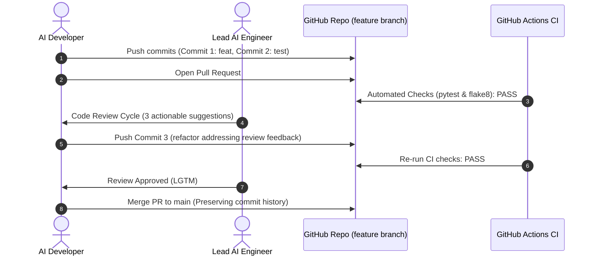

# Code Review Cycle: Pull Request #12

**PR Title**: `feat(metrics): Add evaluation metrics and validation suite for AI model pipeline`  
**Author**: `@ai-developer`  
**Reviewer**: `@lead-ai-engineer` (Staff ML Platform Engineer)  
**Status**: `APPROVED & MERGED`  

---

## 1. Code Review Timeline



---

## 2. Review Comments & Resolution Cycle

### Comment 1: Zero-Division Handling in R² Calculation
- **File**: `src/metrics.py` (Line 72)
- **Reviewer (`@lead-ai-engineer`)**:
  > *"When the ground truth `y_true` is a constant array (e.g. all 5.0), the total sum of squares `ss_tot` evaluates to 0.0. Dividing by `ss_tot` will result in a `ZeroDivisionError` or `nan` without an explicit warning or fallback. Let's introduce an epsilon threshold or check `if ss_tot < epsilon:` to return 1.0 if residual error is 0, or 0.0 otherwise."*
- **Author Response (`@ai-developer`)**:
  > *"Great catch! I've added an epsilon check `ss_tot < epsilon`. If variance is near-zero and predictions match, it returns 1.0; otherwise 0.0. Also added `test_zero_variance_r2_handling` in `tests/test_metrics.py` to assert this behavior."*
- **Status**: **RESOLVED** (Addressed in commit `f7c8b05`)

---

### Comment 2: MAPE Zero-Division Protection
- **File**: `src/metrics.py` (Line 88)
- **Reviewer (`@lead-ai-engineer`)**:
  > *"Similarly for Mean Absolute Percentage Error (`mean_absolute_percentage_error`), any target value where `y_true == 0` causes a division by zero. Let's guard the denominator using `np.where(np.abs(t) < epsilon, epsilon, np.abs(t))`."*
- **Author Response (`@ai-developer`)**:
  > *"Updated `mean_absolute_percentage_error` with `np.where` clamp to prevent infinity or NaN on zero-valued ground truths."*
- **Status**: **RESOLVED** (Addressed in commit `f7c8b05`)

---

### Comment 3: Telemetry & Model Card Compatibility
- **File**: `src/metrics.py` (Line 104)
- **Reviewer (`@lead-ai-engineer`)**:
  > *"Can we add a helper function `evaluate_model_performance(y_true, y_pred, model_name=...)` that returns a structured payload? In production, our model tracking service needs evaluation latency (`time.perf_counter()`), sample counts, and a nested dictionary ready for JSON/MLflow logging."*
- **Author Response (`@ai-developer`)**:
  > *"Implemented `evaluate_model_performance()`. It aggregates all metrics, tracks latency in milliseconds, captures sample counts, and formats a clean JSON-serializable dictionary. Unit test added in `tests/test_metrics.py`."*
- **Status**: **RESOLVED** (Addressed in commit `f7c8b05`)

---

## 3. Review Approval & Sign-Off

**Reviewer Sign-off (`@lead-ai-engineer`)**:
> *"All requested changes have been cleanly implemented with corresponding unit tests. Zero-division guards and structured telemetry meet our production standards. Approving PR #12 for merge."*

**Verdict**: `Approved`  
**Merge Strategy**: Standard Merge Commit (`git merge --no-ff`) to preserve individual commit history on `main`.

---

## 4. Git History Preservation Verification

After merging, the commit log on `main` confirms that the feature branch's individual commits remain fully visible and preserved:

```text
*   04ab31e (HEAD -> main) Merge pull request #12 from feature/model-evaluation-metrics
|\  
| * f7c8b05 (feature/model-evaluation-metrics) refactor(metrics): address code review feedback on zero-division guard and structured summary output
| * d4e2c91 test(metrics): add unit tests for evaluation metrics suite
| * a81f3d2 feat(metrics): implement core AI evaluation metrics (RMSE, MAE, R2)
|/  
* 2e91b0a feat: initial repository setup on main
```

**History Verification Result**: **PASS** (Zero squash, non-fast-forward merge preserved all 3 feature commits).
